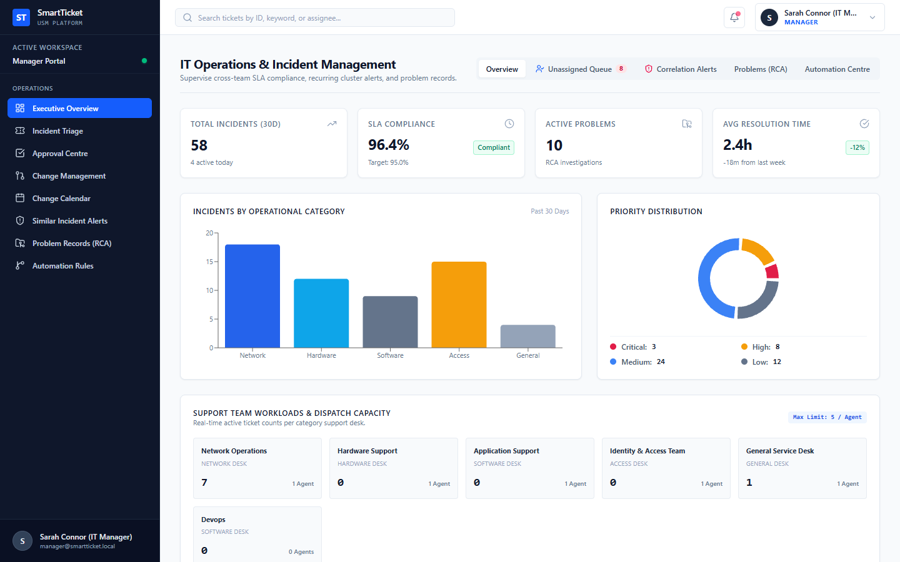
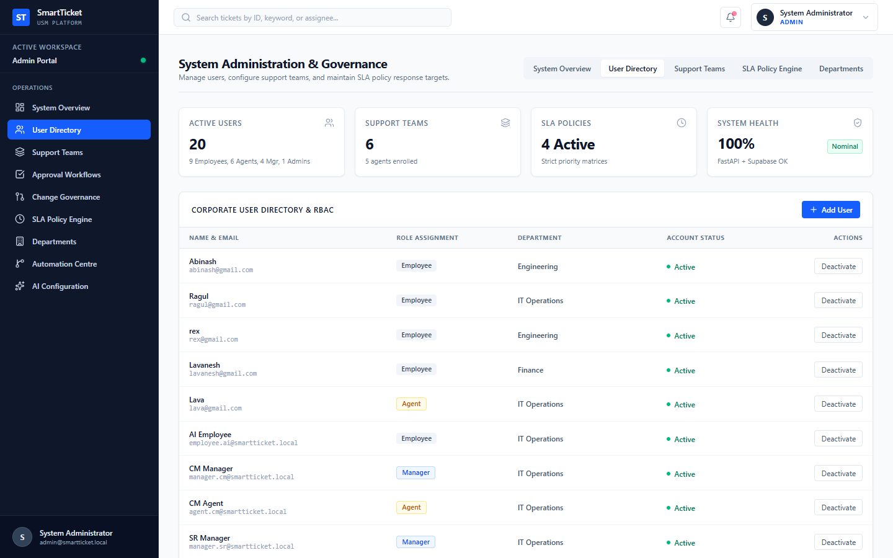
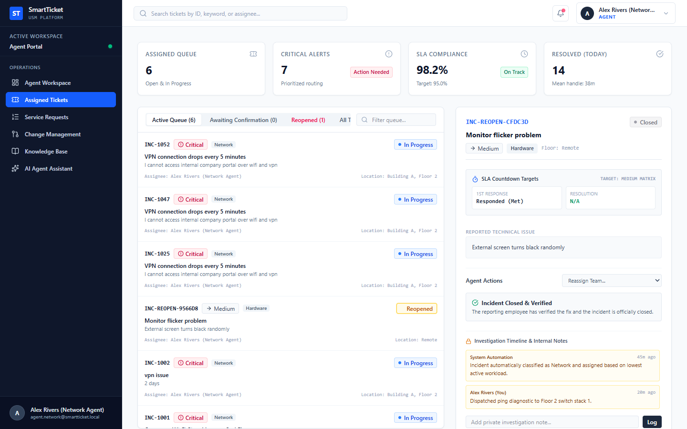
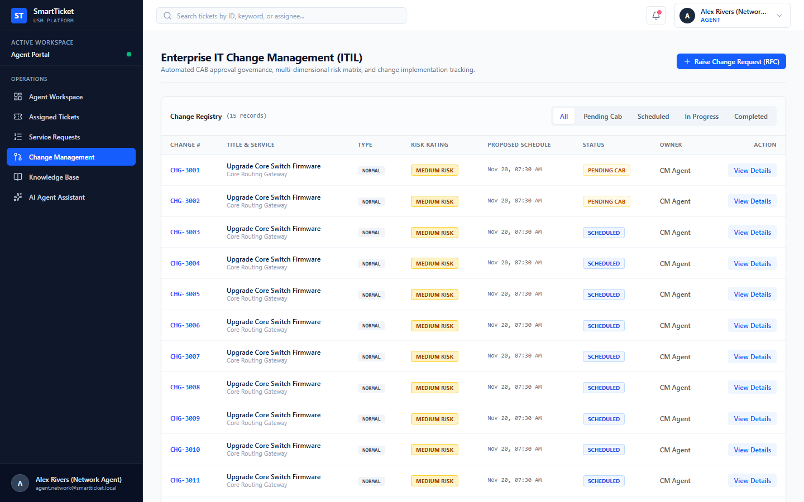

# SmartTicket – Smart IT Service Desk & Workflow Automation Platform

[](https://fastapi.tiangolo.com)
[](https://react.dev/)
[](https://www.typescriptlang.org/)
[](https://vitejs.dev/)
[](https://tailwindcss.com/)
[](https://supabase.com/)
[](https://aistudio.google.com/)
[](https://opensource.org/licenses/MIT)

A full-stack IT Service Management (ITSM) and Workflow Automation platform designed to streamline incident triage, service requests, change approvals, problem management (RCA), and IT support operations through role-based access control (RBAC) and Google Gemini AI assistance.

---

### 🌐 Live Deployments & Repository

| Service | URL |
| :--- | :--- |
| **🌐 Live Frontend Application** | [https://smart-itsm-workflow-platform.vercel.app](https://smart-itsm-workflow-platform.vercel.app) |
| **⚙️ Backend API Engine** | [https://smart-it-service-desk-1qwo.onrender.com](https://smart-it-service-desk-1qwo.onrender.com) |
| **📖 Swagger Interactive API Docs** | [https://smart-it-service-desk-1qwo.onrender.com/docs](https://smart-it-service-desk-1qwo.onrender.com/docs) |
| **💻 GitHub Source Repository** | [https://github.com/Jai7525/Smart-it-service-desk](https://github.com/Jai7525/Smart-it-service-desk) |

---

## 📑 Table of Contents

1. [Project Overview](#-project-overview)
2. [Problem Statement](#-problem-statement)
3. [Key Features](#-key-features)
4. [User Roles & Permissions (RBAC)](#-user-roles--permissions-rbac)
5. [System Architecture](#-system-architecture)
6. [Technology Stack](#-technology-stack)
7. [Project Directory Structure](#-project-directory-structure)
8. [Installation & Setup](#-installation--setup)
9. [Environment Variables](#-environment-variables)
10. [API Endpoints & Documentation](#-api-endpoints--documentation)
11. [Database Design & Schema](#-database-design--schema)
12. [Automated Test Suite](#-automated-test-suite)
13. [Screenshots & UI Walkthrough](#-screenshots--ui-walkthrough)
14. [Future Enhancements](#-future-enhancements)
15. [License](#-license)

---

## 📌 Project Overview

**SmartTicket** is a production-ready, role-based IT Service Desk platform that unifies IT support operations into a single coordinated environment.

The platform tracks the complete ticket lifecycle—from employee issue submission to automated category classification, deterministic priority scoring, least-loaded agent assignment, investigation notes, resolution confirmation, and manager governance.

It also integrates the **Google Gemini API** to assist employees with 24/7 intelligent self-service troubleshooting and one-click incident ticket drafting.

---

## 🎯 Problem Statement

Traditional IT service desks rely on manual email threads, disconnected spreadsheets, and arbitrary ticket assignment. These friction points lead to:

- **Delayed incident resolution** due to manual triage and missing priority standards.
- **Lost ownership & ticket bottlenecks**, where overloaded agents hold open tickets while others remain idle.
- **Premature ticket closures**, leaving employees frustrated by recurring or unresolved problems.
- **Zero visibility into SLAs**, causing compliance breaches without advance warnings.
- **Opaque change management**, risking system outages due to unreviewed infrastructure changes.
- **Untracked technical debt**, treating recurring outages as isolated incidents rather than investigating root causes (RCA).

**SmartTicket** eliminates these challenges with automated triage pipelines, guaranteed SLA countdown timers, mandatory two-way employee resolution confirmations, CAB change governance, and automated problem clustering.

---

## 🚀 Key Features

### 1. Incident Management & Automated Triage Pipeline
- **Sequential Concurrency-Safe ID Generation**: Automatic generation of IDs (`INC-1001`, `INC-1002`).
- **Automated Keyword-Based Classification**: Categorizes incidents into `Network`, `Hardware`, `Software`, `Access`, or `General`.
- **Deterministic 3×3 Priority Matrix**: Calculates Priority (`Critical`, `High`, `Medium`, `Low`) by mapping Impact vs. Urgency.
- **Intelligent Workload-Balanced Auto-Dispatch**: Automatically assigns tickets to the active support agent with the lowest open ticket count in the category team.
- **Real-Time SLA Watchdog**: Computes exact response and resolution deadlines; triggers warnings at 75% elapsed time.
- **Two-Way Resolution Confirmation Workflow**: When an agent resolves a ticket, it enters `resolved` status. The ticket only transitions to `closed` after the employee confirms resolution. If rejected, it returns to `reopened` with mandatory feedback.

### 2. Service Request Management & Dynamic Catalogue
- **Tiered Service Catalogue**: Browse hardware, software licenses, access permissions, and cloud infrastructure requests.
- **Custom Form Specifications**: Collects business justification, required delivery date, and item-specific details.
- **Two-Tier Approval Workflow**: Automatically places requests in `pending_approval` until an authorized Manager approves or rejects.
- **Agent Fulfillment Lifecycle**: Support agents claim approved requests, log fulfillment notes, and transition to `fulfilled`.

### 3. ITIL Change Management & Advisory Board (CAB)
- **Change Risk Scoring**: Calculates change risk levels (`Low`, `Medium`, `High`, `Critical`) based on scope and outage impact.
- **CAB Review Actions**: Managers can approve, reject, or request information on changes.
- **Interactive 30-Day Change Calendar**: Prevents release collisions with scheduling views for standard, emergency, and normal changes.

### 4. Problem Management & Incident Correlation (RCA)
- **Automated Outage Clustering**: Detects when 3 or more incidents in the same category occur within a rolling 30-minute window and alerts managers.
- **Root Cause Analysis (RCA)**: Create Problem records (`PRB-xxx`), document workarounds, attach affected incident tickets, and track permanent fixes.

### 5. Grounded AI Support Assistant (Google Gemini)
- **Natural Language Troubleshooting**: Employees can ask IT questions 24/7 (e.g., *"VPN drops every 5 minutes on Wi-Fi"*).
- **Knowledge-Grounded Retrieval**: Contextualizes suggestions using internal verified technical articles.
- **One-Click Incident Drafting**: If self-troubleshooting fails, the assistant pre-fills an incident ticket directly from the conversation.

### 6. Role-Specific Dashboards & Operational Cockpits
- Custom workspaces designed specifically for Employees, Agents, Managers, and System Administrators.

---

## 👥 User Roles & Permissions (RBAC)

SmartTicket enforces strict Role-Based Access Control (RBAC) across both backend REST endpoints and frontend navigation:

| Role | Default Demo Account | Permissions & Operational Scope |
| :--- | :--- | :--- |
| **Employee** | `employee.john@smartticket.local` | • Submit incidents & service requests<br>• Track personal ticket progress<br>• Confirm or reject ticket resolutions<br>• Access Knowledge Base & AI Assistant |
| **IT Agent** | `agent.network@smartticket.local` | • Operational Workspace cockpit & SLA urgent watchlist<br>• Dedicated triage queue (`My Queue`, `Awaiting Confirmation`, `Reopened`)<br>• Add investigation notes & transition ticket status to `in_progress` / `resolved`<br>• Claim and fulfill approved service requests |
| **IT Manager** | `manager@smartticket.local` | • Executive SLA metrics & department health analytics<br>• Manual ticket reassignment & triage override<br>• Service Request & CAB Change Approval Centre<br>• Problem Management (RCA) & Incident Correlation alerts |
| **System Admin** | `admin@smartticket.local` | • Corporate User Directory & RBAC role provisioning<br>• Category Support Team dispatch configuration<br>• Dynamic SLA policy deadline adjustments<br>• System health monitoring & department governance |

---

## 🏗️ System Architecture

SmartTicket uses a modular, cloud-native decoupled architecture:


 

                   


---

## 🛠️ Technology Stack

| Layer | Technologies | Purpose |
| :--- | :--- | :--- |
| **Frontend UI** | **React 19**, **TypeScript 5.9**, **Vite 8.3** | High-performance single-page web application |
| **Styling** | **Tailwind CSS 4.1**, **Lucide React** | Modern design with accessible contrast and zero CLS |
| **Backend API** | **Python 3.13**, **FastAPI 0.115**, **Uvicorn** | High-concurrency async REST API engine |
| **ORM & Models** | **SQLModel 0.0.22**, **SQLAlchemy 2.0**, **Pydantic v2** | Type-safe database queries and schema validation |
| **Database** | **Supabase PostgreSQL** (`ap-northeast-1`) | Cloud-hosted relational persistence and session pooling |
| **AI Integration** | **Google Gemini API** (`google-genai` SDK) | Grounded AI ticket drafting & IT self-service |
| **Testing** | **Pytest 9.2**, **pytest-asyncio**, **HTTPX** | Automated unit, regression, and end-to-end integration test suite |
| **Hosting & CI/CD** | **Vercel** (Frontend) & **Render** (Backend) | Automatic continuous deployment on push to `main` |

---

## 📁 Project Directory Structure

```text
Smart_Ticket/
├── frontend/                         # React 19 + TypeScript SPA
│   ├── public/
│   │   ├── favicon.svg               # SmartTicket SVG monogram favicon
│   │   ├── robots.txt                # Search crawler directive
│   │   ├── llms.txt                  # LLM agent discoverability manifest
│   │   └── .well-known/ard.json      # Agentic Resource Discovery (ARD) manifest
│   ├── src/
│   │   ├── assets/                   # Vector illustrations & static media
│   │   ├── components/               # AppSidebar, TopNavbar, StatCard, Badges
│   │   ├── context/                  # AuthContext (Supabase / RBAC state)
│   │   ├── pages/                    # 12 role-specific views
│   │   │   ├── LoginPage.tsx         # Modern two-column login with quick demo access
│   │   │   ├── EmployeeDashboard.tsx # Employee ticket & resolution confirmation
│   │   │   ├── AgentWorkspacePage.tsx# Agent operational cockpit & SLA watchlist
│   │   │   ├── AgentDashboard.tsx    # Agent ticket investigation workbench
│   │   │   ├── ManagerDashboard.tsx  # Executive overview, RCA, and correlations
│   │   │   ├── AdminDashboard.tsx    # User directory, teams, SLA policies
│   │   │   ├── ServiceCatalogPage.tsx# Service request catalogue
│   │   │   ├── MyTicketsPage.tsx     # Comprehensive incident ticket list
│   │   │   ├── ChangeManagementPage.tsx # ITIL change records & CAB approvals
│   │   │   ├── ChangeCalendarPage.tsx# Interactive 30-day change schedule
│   │   │   ├── KnowledgeBasePage.tsx # Technical self-service articles
│   │   │   └── AIAssistantPage.tsx   # Gemini-powered IT conversational bot
│   │   ├── services/api.ts           # Centralized API fetch wrapper
│   │   ├── types/index.ts            # Enterprise TypeScript interfaces
│   │   └── App.tsx                   # Role-gated routing configuration
│   ├── index.html                    # HTML5 entry with preconnect optimizations
│   ├── package.json
│   └── vite.config.ts
│
├── src/smart_ticket/                 # FastAPI backend application package
│   ├── api/v1/                       # Versioned REST API routers
│   │   ├── admin.py                  # User management, teams, SLA configuration
│   │   ├── auth.py                   # Authentication & profile endpoints
│   │   ├── incidents.py              # Incident creation, lifecycle, resolution
│   │   ├── service_requests.py       # Catalog items & service request approvals
│   │   ├── changes.py                # ITIL change control & CAB workflows
│   │   ├── problems.py               # Root Cause Analysis (RCA) problem records
│   │   ├── knowledge.py              # Knowledge base retrieval & voting
│   │   ├── ai.py                     # Google Gemini AI assistant endpoint
│   │   └── analytics.py              # SLA compliance & executive metrics
│   ├── core/
│   │   ├── config.py                 # Pydantic Settings & environment validation
│   │   ├── database.py               # Supabase session generator with connection pooler
│   │   └── security.py               # Role-based access control dependencies
│   ├── models.py                     # Relational SQLModel tables & schema definitions
│   ├── schemas.py                    # Pydantic request/response transfer schemas
│   ├── services/                     # Business logic and triage engines
│   │   ├── assignment.py             # Workload-balanced least-loaded agent dispatch
│   │   ├── classification.py         # Keyword categorization engine
│   │   ├── priority.py               # 3x3 Impact/Urgency calculation engine
│   │   ├── similarity.py             # Incident clustering & major incident detection
│   │   └── sla.py                    # SLA deadline calculation & watchdog
│   └── main.py                       # FastAPI application entrypoint & CORS middleware
│
├── tests/                            # Automated Pytest suite
│   ├── test_advanced_modules.py      # Service requests, change control, AI tests
│   ├── test_api.py                   # API router integration tests
│   ├── test_assignment_rules.py      # Least-loaded agent assignment tests
│   ├── test_engines.py               # Priority, classification, SLA engine unit tests
│   └── test_resolution_confirmation.py# Confirmation & reject/reopen tests
│
├── pyproject.toml                    # Poetry dependency specification
├── render.yaml                       # Render cloud deployment manifest
└── README.md
```

---

## ⚙️ Installation & Setup

### Prerequisites
- **Python 3.11+** (Python 3.13 recommended)
- **Node.js 18+** and **npm**
- **Git**
- A **Supabase** project (PostgreSQL database)
- A **Google Gemini API Key** (optional, for AI features)

---

### 1. Clone the Repository
```bash
git clone https://github.com/Jai7525/Smart-it-service-desk.git
cd Smart-it-service-desk
```

---

### 2. Backend Setup
Create and activate a Python virtual environment:

**Windows (PowerShell):**
```powershell
python -m venv .venv
.\.venv\Scripts\activate
```

**macOS / Linux:**
```bash
python3 -m venv .venv
source .venv/bin/activate
```

Install backend dependencies:
```bash
pip install -e .
```

Run database migrations and start the development server:
```bash
uvicorn smart_ticket.main:app --reload --port 8080
```
The backend API will be available at: **`http://127.0.0.1:8080`**  
Interactive API Docs (Swagger): **`http://127.0.0.1:8080/docs`**

---

### 3. Frontend Setup
In a new terminal, navigate to the `frontend` directory:
```bash
cd frontend
npm install
npm run dev
```
The React development server will start at: **`http://localhost:3000`**

---

## 🔐 Environment Variables

Create a `.env` file in the project root directory:

```env
# Database Connection (Supabase PostgreSQL)
DATABASE_URL=postgresql://postgres.<project_ref>:<password>@aws-0-ap-northeast-1.pooler.supabase.com:6543/postgres

# Supabase Auth Integration
SUPABASE_URL=https://<project_ref>.supabase.co
SUPABASE_KEY=your_supabase_anon_or_service_key
SUPABASE_JWT_SECRET=your_supabase_jwt_secret

# Google Gemini AI Integration
GEMINI_API_KEY=your_gemini_api_key

# Application Settings
ENVIRONMENT=development
MAX_ACTIVE_TICKETS_PER_AGENT=5
```

For the frontend, specify the backend URL (optional in local development due to Vite's proxy):
```env
VITE_API_URL=https://smart-it-service-desk-1qwo.onrender.com
```

---

## 📡 API Endpoints & Documentation

SmartTicket provides complete interactive OpenAPI documentation out of the box:

- **Swagger UI**: [`/docs`](https://smart-it-service-desk-1qwo.onrender.com/docs)
- **ReDoc**: [`/redoc`](https://smart-it-service-desk-1qwo.onrender.com/redoc)
- **Raw OpenAPI Schema**: [`/openapi.json`](https://smart-it-service-desk-1qwo.onrender.com/openapi.json)

### Primary API Routes:
| Method | Endpoint | Description | Role Required |
| :--- | :--- | :--- | :--- |
| `POST` | `/api/auth/login` | Email-based login with dynamic profile return | Public |
| `GET` | `/api/incidents/` | List incidents (filtered by role isolation) | Authenticated |
| `POST` | `/api/incidents/` | Create incident and run automated triage | Employee / Agent |
| `PATCH` | `/api/incidents/{id}/status` | Update incident status (`in_progress`, `resolved`) | Agent / Manager |
| `PATCH` | `/api/incidents/{id}/confirm-resolution` | Confirm ticket resolution (transitions to `closed`) | Employee (Reporter) |
| `PATCH` | `/api/incidents/{id}/reject-resolution` | Reject resolution (transitions back to `reopened`) | Employee (Reporter) |
| `GET` | `/api/service-catalog/` | List available service items | Authenticated |
| `POST` | `/api/service-requests/` | Submit a new service request | Employee |
| `POST` | `/api/service-requests/{id}/approve` | Approve service request | Manager / Admin |
| `GET` | `/api/changes/` | List ITIL change management records | Agent / Manager |
| `POST` | `/api/changes/` | Create change request with auto-risk score | Agent / Manager |
| `POST` | `/api/ai/chat` | Grounded AI IT support assistant query | Authenticated |
| `GET` | `/api/admin/users` | List corporate users with department names | Admin |
| `POST` | `/api/admin/users` | Provision new user with assigned role | Admin |
| `GET` | `/api/admin/teams` | List teams with live agent counts & workloads | Admin / Manager |
| `PUT` | `/api/admin/sla-policies` | Update SLA response and resolution targets | Admin |

---

## 🗄️ Database Design & Schema

SmartTicket uses normalized PostgreSQL tables managed via **SQLModel**:

```text
┌─────────────────┐       ┌─────────────────┐       ┌─────────────────┐
│   departments   │◄──────┤    profiles     ├──────►│   team_members  │
├─────────────────┤       ├─────────────────┤       ├─────────────────┤
│ id (PK)         │       │ id (PK)         │       │ team_id (FK)    │
│ name            │       │ email (Unique)  │       │ agent_id (FK)   │
│ description     │       │ full_name       │       └────────┬────────┘
└─────────────────┘       │ role (Enum)     │                │
                          │ department_id   │                ▼
                          │ is_active       │       ┌─────────────────┐
                          │ is_available    │       │  support_teams  │
                          └────────┬────────┘       ├─────────────────┤
                                   │                │ id (PK)         │
                                   │                │ name            │
                                   ▼                │ category (Enum) │
                          ┌─────────────────┐       └─────────────────┘
                          │    incidents    │
                          ├─────────────────┤
                          │ id (PK)         │
                          │ ticket_number   │
                          │ subject         │
                          │ category (Enum) │
                          │ priority (Enum) │
                          │ status (Enum)   │
                          │ reporter_id (FK)│
                          │ assigned_team_id│
                          │ assigned_agent  │
                          │ response_deadln │
                          │ resolutn_deadln │
                          └─────────────────┘
```

- **`profiles`**: Stores corporate identity, email, assigned role (`employee`, `agent`, `manager`, `admin`), availability status, and department link.
- **`incidents`**: Central ticket table with priority ratings, status enum, SLA deadlines, and resolution tracking.
- **`support_teams` & `team_members`**: Organizes agents into category teams (`Network`, `Hardware`, `Software`, `Access`, `General`).
- **`service_requests` & `catalog_items`**: Manages the procurement catalog, item pricing, and manager approval states.
- **`change_requests`**: Stores ITIL RFC records, CAB decisions, rollback plans, and risk ratings.
- **`problem_records`**: Tracks root cause analysis (RCA), recurring incident links, and workarounds.
- **`sla_policies`**: Configures response and resolution targets in hours per priority tier.

---

## 🧪 Automated Test Suite

SmartTicket includes a comprehensive Pytest automated test suite covering unit tests, assignment rules, negative boundary tests, and end-to-end integration workflows.

To run the test suite:
```bash
pytest -v
```

### Verified Test Results:
```text
tests/test_advanced_modules.py::test_service_request_lifecycle PASSED            [  6%]
tests/test_advanced_modules.py::test_change_management_lifecycle PASSED          [ 12%]
tests/test_advanced_modules.py::test_ai_support_assistant PASSED                 [ 18%]
tests/test_api.py::test_root_endpoint PASSED                                     [ 25%]
tests/test_api.py::test_create_incident_end_to_end PASSED                         [ 31%]
tests/test_api.py::test_problem_management PASSED                                [ 37%]
tests/test_assignment_rules.py::test_only_agents_assigned_for_all_categories PASSED [ 43%]
tests/test_assignment_rules.py::test_lowest_active_workload_selected PASSED       [ 50%]
tests/test_assignment_rules.py::test_api_reassign_rejects_manager_and_employee PASSED [ 56%]
tests/test_assignment_rules.py::test_workload_capacity_and_unassigned_trigger PASSED [ 62%]
tests/test_engines.py::test_classification_engine PASSED                         [ 68%]
tests/test_engines.py::test_priority_matrix PASSED                               [ 75%]
tests/test_engines.py::test_sla_calculation PASSED                               [ 81%]
tests/test_resolution_confirmation.py::test_full_resolution_confirmation_lifecycle PASSED [ 87%]
tests/test_resolution_confirmation.py::test_rejection_and_reopen_workflow PASSED  [ 93%]
tests/test_resolution_confirmation.py::test_invalid_lifecycle_transition_guards PASSED [100%]

============================== 16 passed in 1.48s ==============================
```

---

## 📸 Screenshots & UI Walkthrough

### 1. Executive Dashboard (Manager Overview & Metrics)

*Executive overview displaying real-time incident resolution trends, category breakdowns, and active SLA compliance.*

### 2. User Directory & Governance (Admin Role)

*Centralized user provisioning table displaying roles, departments, active status indicators, and RBAC controls.*

### 3. Ticket & Incident Management (Agent Workbench)

*Dedicated agent triage center with filter tabs, countdown SLA timers, status updates, and timeline notes.*

### 4. AI Assistant & Change Management (CAB Governance)

*ITIL Change Advisory Board (CAB) review center with dynamic risk scoring, approval actions, and 30-day change calendar.*

---

## 🔮 Future Enhancements

- [ ] **Omnichannel Notifications**: Outbound webhook alerts via Slack, Microsoft Teams, and SendGrid email.
- [ ] **Expanded Multilingual AI**: Multi-language real-time translation for global service desks.
- [ ] **Asset Management (CMDB)**: Integration of hardware asset tracking with automatic configuration item (CI) binding.
- [ ] **Enterprise Single Sign-On**: SAML 2.0 and Okta / Azure AD identity verification.
- [ ] **Predictive Outage Analytics**: Machine learning models forecasting infrastructure failures from telemetry logs.

---

## 📄 License

This project is licensed under the **MIT License** – see the [LICENSE](LICENSE) file for details.

---

### 👨‍💻 Author & Maintainer
**Jayakumar M**  
GitHub: [@Jai7525](https://github.com/Jai7525)  
Repository: [https://github.com/Jai7525/Smart-it-service-desk](https://github.com/Jai7525/Smart-it-service-desk)
